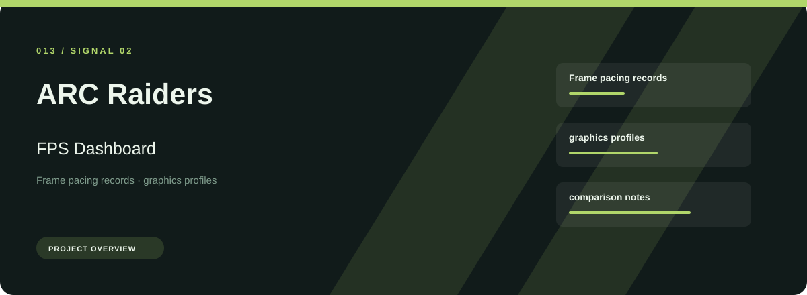
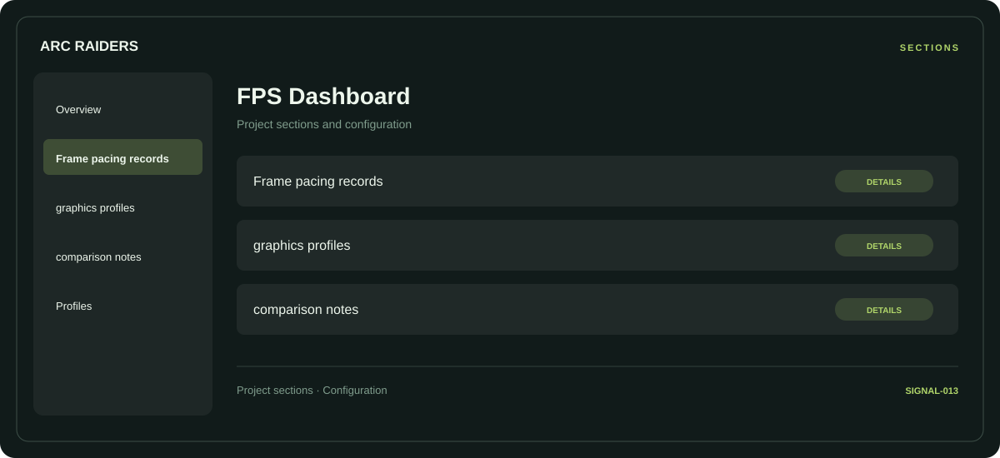

# 🎮 ARC Raiders FPS Dashboard

**Frame pacing records · Graphics profiles · Comparison notes**

## ⚡ Features

ARC Raiders FPS Dashboard focuses on three connected areas: frame pacing records, graphics profiles, comparison notes. Its organization keeps frequently used options close to the context they belong to.

### ⚙️ Frame pacing records

Display or performance-related options, with space for configuration and comparison information.

### 🧩 Graphics profiles

Related settings collected into named groups for a clearer configuration workflow.

### ⌨️ Comparison notes

A dedicated section for comparison notes and the configuration details associated with that area.

## 🖥️ Project navigation

## 📥 Download

The button and cover open the project's download page. Use the information supplied with the downloaded package for installation and release-specific requirements.

## 📚 Project documentation

- [Feature reference](docs/FEATURES.md)
- [Download information](docs/DOWNLOAD.md)
- [Project page](index.html)

---

ARC Raiders FPS Dashboard · Program documentation and download information.
